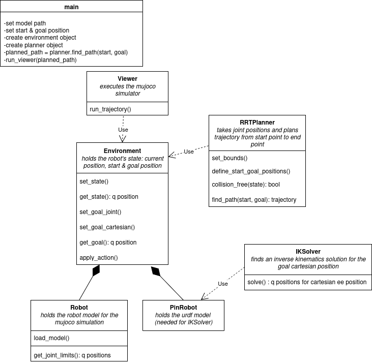

# Franka Emika Panda Simulation
## Overview

Goal: simulation of a panda robot for manipulation of objects

## Setup
Ubuntu-Version 24.04
1. install mujoco via pip
2. install ompl with python wheels
pip install wheel
https://ompl.kavrakilab.org/installation.html
pip install ompl-1.7.0-cp310-cp310-manylinux_2_28_x86_64.whl 
OR use environment.yml

## Files
- udrf file
- mujoco xml
- assets

## Software Requirements

## Code Arquitecture

<p float="left">
  
</p>


Environment:
- owns Robot & PinRobot
- holds current state & goal
- exposes apply_action() to update robot's state

Planner:
- gets current state + goal from Environment
- computes action sequence (joint configs trajectory)
- returns that sequence

Robot:
- holds the robot's model information in MJCF format

PinRobot:
- holds the robot's model information in URDF format

IKSolver:
- uses the robot's urdf model and target position to get an IK solution

Main:
- create Environment
- create Planner
- call planner with env info
- send planned actions back to env to apply
- env’s Viewer visualizes it

Cartesian goal → IKPlanner → q_goal → RRTPlanner → joint trajectory → Viewer


## Some Theory

**Joint ID vs. Frame ID**

A joint describes a degree of freedom in the kinematic chain (rotation, translation, etc.).

A frame is a coordinate system attached to a joint, link, or custom location in your robot model.

**Body vs. Site**

A **body** is a rigid object in the model. Each body has:
- a position
- an orientation
- physical properties like mass, intertia

They define the structure of the robot: links, base, end-effector etc.

A **site** is just a fixed coordinate frame (position + orientation) attached to a body. It has no mass, no inertia and doesn't affect physics. We use it to track a specific location on the robot.

Example:
  
    <body name="hand">
    <site name="ee_site" pos="0 0 0.05" size="0.01 0.01 0.01" rgba="1 0 0 1"/>
    </body>

**Scaling:**

In mujoco the unit scale is 1.0 m. So when loading a CAD model, it has to be imported with the scale parameter: ``` scale="0.001 0.001 0.001"```.For for primitive shapes like ```<geom type="box"> ``` mujoco will be using half-length parameters, so every scale you give has to be divided by 2 to get the actual size. 
E. g. you want to define a box with 1.0 m lenght and 1.0 m width, you define it like this:
```<geom type="box" size="0.5 0.5 0.05"/>```